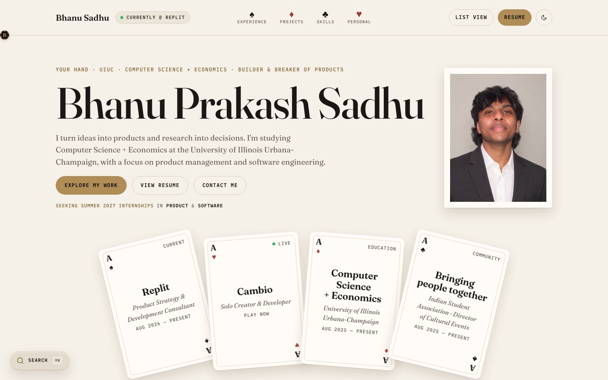
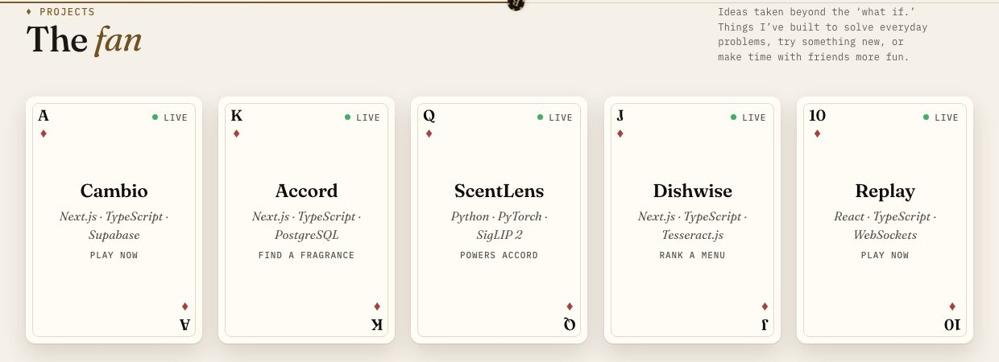

# Your Hand

[](https://bhanusadhu.com)

My experience, projects, and interests, dealt as interactive cards. Check it out!

**[Visit → bhanusadhu.com](https://bhanusadhu.com)** · [Resume](https://bhanusadhu.com/Bhanu_Sadhu_Resume.pdf) · LinkedIn: in/bhanusadhu · Email: sadhubhanu07@gmail.com

---

## Hi, I'm Bhanu

A Computer Science + Economics student at the University of Illinois Urbana-Champaign, with minors in Statistics and Advertising. I build products and then try to break them.

**Recruiting for Summer 2027 internships in Product & Software.**



---

## What's in the deck

Everything on the site links to something real. The builds, each with its live link:

| Build | What it is | Live |
| --- | --- | --- |
| **Cambio** | Real-time multiplayer card game with house bots at three levels | [play](https://cambio.bhanusadhu.com) |
| **Accord** | Fragrance discovery app with recommendations that show their evidence | [try](https://accord.bhanusadhu.com) |
| ↳ **ScentLens** | The model behind Accord's bottle scanner: names a fragrance from a photo, or says it isn't sure | [demo](https://scentlens.bhanusadhu.com) |
| **Dishwise** | Ranks every dish on a menu against your taste, with the reasons behind each score | [try](https://dishwise.bhanusadhu.com) |
| **Replay** | Live guess-the-song game: one screen plays the music, every phone is a buzzer | [play](https://replay.bhanusadhu.com) |
| **Replit Learnathon** | Event site and project wall for a beginner AI build day, built in my Replit role | [visit](https://learnathon.bhanusadhu.com) |



---

## Recruiters: a 60-second tour

No install, no login. Open the [live site](https://bhanusadhu.com) and:

1. **Start at the top.** The four aces are my strongest work, each linking to its full entry.
2. **Want it fast?** Hit **List view** for the same content laid flat, easy to skim.
3. **Looking for something specific?** Press **⌘K** (or **/**) and search any role, project, skill, or credential.
4. **Need the resume?** **View Resume** is in the hero and the nav.
5. **Want to reach me?** The last section is a contact form that emails me directly.

| Section | On the site | What's in it |
| --- | --- | --- |
| Hero | **Your hand** | Who I am, what I'm seeking, and four aces linking to fuller entries |
| Experience | **The spread** | Roles laid out as a row of cards |
| Leadership | **The face cards** | Kings, queens, and jacks, dealt three to a suit |
| Projects | **The fan** | Things I've built, with unbuilt ideas face down as “Not dealt yet” |
| Skills + certifications | **The chips** | Chip stacks with the real count beside each |
| Personal | **The flop** | Four cards covering interests |
| Contact | **Let's talk** | The contact form |

A resume is a hand you're dealt and how you play it, so the whole site is a deck. Each experience and project also has its own shareable page at `/experience/:slug` or `/projects/:slug`.

---

## What the build shows

The site is also a project, built end to end by me: design, front end, and a small backend, deployed on Vercel.

- **Product sense:** one content source feeds the card view, the list view, search, and the sitemap, so nothing drifts between them.
- **Craft:** custom design system with a dark and a light theme, an opening deal animation, keyboard and screen-reader support, and reduced-motion fallbacks.
- **Engineering:** React 19 + TypeScript with a custom router and only two runtime dependencies. Two Vercel Functions: a contact form that validates, filters bots, and sends mail through Resend, and a live player count for Cambio.

---

## Product decisions

| Decision | Why |
| --- | --- |
| **A deck of cards, not a scroll of sections** | A resume is a hand you're dealt and how you play it. The metaphor gives every section a name and a shape a recruiter remembers. |
| **A list view of the same content** | The cards are for exploring; the list is for a recruiter with 60 seconds. Both read from one source, so they cannot say different things. |
| **Every claim is checkable** | Projects link to a live product and its code, team results are credited to the team, and live numbers (Cambio's player count) are fetched, not typed in. No GPA, no ratings, no invented metrics. |
| **Detail pages with their own URLs** | A recruiter can share one project or role without sending the whole site. |
| **Search everything** | ⌘K finds any role, project, skill or credential, and opens it in place. |
| **Accessible by default** | Text holds 4.5:1 contrast in both themes, Increase Contrast and Reduce Transparency are honored, every motion has a reduced-motion fallback, and the keyboard reaches everything. |

---

## Highlights

| Feature | What it does |
| --- | --- |
| **Interactive cards** | Click a card to flip it open, fill its row, and slide neighboring cards into slivers. Escape closes it. |
| **Two ways to browse** | Switch between the card layout and a flat `/list` view of the same content, plus Education. Navigation follows the active view. |
| **Shareable detail pages** | Each experience and project has its own URL at `/experience/:slug` or `/projects/:slug`. |
| **Search** | A “Search ⌘K” pill, Cmd/Ctrl+K, or “/” opens a palette that finds any section, role, project, skill, credential, personal card, or link. Leadership and personal results flip their card open. |
| **Opening deal** | On the first visit to `/` a deck riffle-shuffles and deals the four aces into the hero's hand. Once per session, never for a `#section` link or reduced motion. |
| **Light and dark** | Dark by default, with a light theme behind the sun/moon button in the nav. The choice is saved and applied before first paint, so nothing flashes. |
| **Motion** | The name rises letter by letter, cards tilt with glare, sections reveal on scroll, stats count up, and chips drop onto their stacks. |
| **Scroll chip** | A monogram chip, the same mark as the favicon, rolls along the line under the nav as you scroll. Drag it left or right and the page scrolls with it. |
| **The felt** | The footer closes on a canvas strip of drifting characters with suits on the crest and a ripple that follows the cursor. Decorative, paused off screen. |
| **Table sounds** | Card flips, deals, chip clacks and a glass tink on the fragrance shelf, synthesized with Web Audio (no audio files). Silent until the first click, with a speaker toggle in the nav (the footer on phones). |
| **Live numbers** | Cambio's player count is fetched at page load through `/api/cambio-players`, falling back to the built-in number if the request fails. |
| **Resume in one click** | “View Resume” opens the PDF in a new tab. |
| **Serverless contact form** | Validates messages, filters bot submissions, and sends email through Resend with the visitor's address as the reply-to. |
| **Clear delivery feedback** | Failed email delivery shows an error and a direct email address. |
| **Social previews and discovery** | Includes a social preview image, `robots.txt`, and a sitemap generated from the same data used by the router. |
| **Keyboard support** | Card fronts are buttons, backs are labelled regions, and focus moves into an opened card and returns when it closes. |
| **Reduced motion** | Replaces flips with fades and removes the deal-in animation when reduced motion is enabled. |
| **Responsive layout** | Uses a desktop card layout and stacked sections on phones. |

---

## Tech stack

Small on purpose. The only runtime dependencies are React and React DOM.

| Component | Technology |
| --- | --- |
| UI | React 19 |
| Language | TypeScript 5.9 |
| Build | Vite 7 with `@vitejs/plugin-react` |
| Hosting | Vercel |
| Backend | Two Vercel Functions: `api/contact.ts` and `api/cambio-players.ts` |
| Email | Resend, called through its REST API without an SDK |
| Styling | Plain CSS with design tokens |
| Animation | CSS and a small in-house motion module, with no animation library |
| Routing | Custom router with anchor links, view transitions, and scroll restoration |
| Headlines | Fraunces |
| Metadata | IBM Plex Mono |

---

## How it works

### Shared content

All content lives in typed files under `src/data/`. The card view, list view, and detail pages read from the same source, keeping content consistent across layouts.

| View | Purpose |
| --- | --- |
| Card view | Interactive portfolio organized around the poker theme |
| List view | Flat layout for quickly scanning the same content, plus Education |
| Detail pages | Individual experience and project entries with shareable URLs |

### Card interaction

Opening a card flips it, expands it across the row, and slides the remaining cards back into slivers.

| Interaction | Behavior |
| --- | --- |
| Open a card | Flips and expands the selected card |
| Focus on open | Moves keyboard focus into the expanded content |
| Press Escape | Closes the card |
| Focus on close | Returns focus to the card's trigger |
| Enable reduced motion | Uses a fade and skips the deal-in animation |

### Search

`CommandPalette` is built from `src/data`, so it cannot drift from the content. Experience and project results open their pages. Leadership, personal, and Education results flip the card open in the card view, or scroll to the section in the list view.

### Contact form

The contact form posts to `api/contact.ts`, which validates the submission, filters bots, and sends the message through Resend.

| Step | Behavior |
| --- | --- |
| Validation | Checks the submitted message before sending |
| Bot filtering | Drops submissions identified as bots |
| Email delivery | Sends the message to the configured recipient through Resend |
| Reply-to | Uses the visitor's email address so replies go directly to them |
| Delivery failure | Shows an error and provides a direct email address |

---

## Project layout

| Path | Responsibility |
| --- | --- |
| `api/contact.ts` | Vercel Function behind the contact form |
| `api/cambio-players.ts` | Vercel Function that passes Cambio's public player count to the site |
| `public/` | Resume PDF, social preview image, favicon, and `robots.txt` |
| `src/data/` | Typed content shared across views |
| `src/components/` | Reusable components including Card, CardRow, Chips, Nav, Footer, CommandPalette, Opening, and Felt |
| `src/sections/` | Hand, Spread, FaceCards, Fan, ChipsSection, Flop, and CallOrFold |
| `src/pages/` | Home, ListView, ExperienceDetail, ProjectDetail, and NotFound |
| `src/lib/router.tsx` | Custom routing, view transitions, and scroll restoration |
| `src/lib/` | Theme, motion, search-to-card dealing, and other helpers |
| `src/styles/` | Design tokens and styles for the base layout, cards, sections, and pages |

---

## Run it locally

Use a Node.js version supported by Vite 7.

### 1. Clone and install

```bash
git clone https://github.com/bhnsadhu/personal-website.git
cd personal-website
npm install
```

### 2. Configure environment variables

```bash
cp .env.example .env
```

Add the values described in the environment variables section below.

### 3. Start the development server

```bash
npm run dev
```

| Command | What it does |
| --- | --- |
| `npm run dev` | Starts the Vite development server |
| `npm run build` | Runs `tsc -b`, including `api/`, then builds to `dist/` |
| `npm run preview` | Serves the production build locally |
| `npm run typecheck` | Runs the type checker without building |

The Vite development server does not run `/api`, so the contact form shows its error state locally. To test delivery end to end, use a Vercel deployment with `RESEND_API_KEY` configured.

---

## Environment variables

The local `.env` file is gitignored. Keep real credentials out of version control.

| Variable | Required | Purpose |
| --- | --- | --- |
| `RESEND_API_KEY` | Yes, for email delivery | Authenticates the server function with Resend. Without it, the endpoint returns 503 and the form displays an error. |
| `CONTACT_TO` | No | Destination address. Defaults to `sadhubhanu07@gmail.com`. |
| `CONTACT_FROM` | No | Sender address. Defaults to `Portfolio <hello@bhanusadhu.com>`. Must use a domain verified in Resend. |

`RESEND_API_KEY` is read from `process.env` inside the server function. It must never use a `VITE_` prefix, which would expose it to the client bundle.

For deployed builds, set these variables in the Vercel project settings.

---

## Deployment

Hosted on Vercel, with a static front end and two serverless endpoints: the contact form and Cambio's live player count.

| Configuration | Behavior |
| --- | --- |
| SPA routing | `vercel.json` rewrites application routes to the single-page app |
| API routing | `/api/*` is excluded from the SPA rewrite |
| Asset caching | Hashed assets are cached for one year |
| Sitemap | `sitemap.xml` is generated from the route data and served from the filesystem |
| Crawler rules | `robots.txt` is served from the filesystem before the SPA rewrite |

---

Shuffled, not stirred.

---

Designed and built by me, [Bhanu Sadhu](https://bhanusadhu.com).
