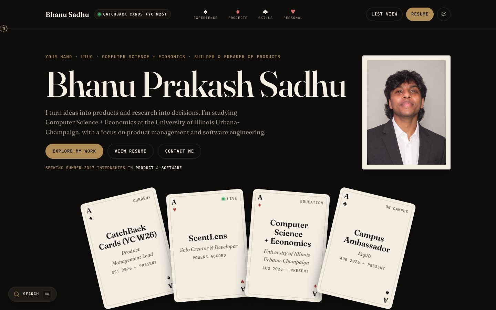

# Bhanu Sadhu

**Computer Science and Economics at the University of Illinois Urbana-Champaign, building products and software across digital health, AI and consumer apps.** Seeking Summer 2027 internships in Product & Software.

**[bhanusadhu.com](https://bhanusadhu.com)** · **[Resume](public/Bhanu_Sadhu_Resume.pdf)**




## About

I'm a Computer Science and Economics student with minors in Statistics and Advertising. My experience spans digital health, AI adoption, consulting and building products of my own, and I like working out what people need, deciding what matters and shipping it. Outside of work I play cards with friends, try restaurants, collect fragrances and watch movies, and all of that ends up on the site.

## Looking for

**Summer 2027 internships in Product & Software**, with both tracks equal.

## Experience

| Role | Where | When |
| --- | --- | --- |
| Product Management Lead | CatchBack Cards (YC W26), San Francisco | Oct 2026 to present |
| Product Strategy and Development Consultant | Replit, Foster City | Aug 2026 to present |
| Campus Ambassador | Replit, Champaign | Aug 2026 to present |
| Senior Strategy Consultant | Confidential media production firm, Evergreen Park | Aug 2026 to present |
| Product Builder Intern | Ingenio Care, Lombard | May 2026 to Aug 2026 |
| Strategy Consultant | Confidential manufacturer, Macomb | Jan 2026 to May 2026 |
| Strategy Consultant | AviLux, Champaign | Jan 2026 to May 2026 |

Some of what I measured along the way: I led the web-to-mobile redesign across **eight feature areas** for Ingenio Care's App Store launch and built a patient and provider outreach pipeline of **750+ contacts** across eight healthcare networks. For a manufacturer I evaluated **500+ product applications across 10 industries** and narrowed them to 12 expansion opportunities, and for AviLux I mapped **15+ FAA and state regulatory requirements** into a compliance roadmap for a proposed pilot. Campus leadership: Product Space, Disruption Lab at Gies, Illinois Business Consulting, the Indian Student Association and Ghungroo Dance Company.

## Featured projects

| Project | What it is | Link |
| --- | --- | --- |
| **Accord** | Fragrance discovery that explains every pick, with a bottle scanner | [accord.bhanusadhu.com](https://accord.bhanusadhu.com) · [repo](https://github.com/bhnsadhu/accord) |
| **ScentLens** | Names a fragrance from one photo of its bottle, or says it is not sure | [scentlens.bhanusadhu.com](https://scentlens.bhanusadhu.com) · [repo](https://github.com/bhnsadhu/scent-lens) |
| **Cambio** | A real-time four-player memory card game with measured house bots | [cambio.bhanusadhu.com](https://cambio.bhanusadhu.com) · [repo](https://github.com/bhnsadhu/cambio) |
| **Dishwise** | Ranks every dish on a menu photo for your taste, read on the device | [dishwise.bhanusadhu.com](https://dishwise.bhanusadhu.com) · [repo](https://github.com/bhnsadhu/dishwise) |
| **Replay** | A live guess-the-song party game styled as an arcade cabinet | [replay.bhanusadhu.com](https://replay.bhanusadhu.com) · [repo](https://github.com/bhnsadhu/replay) |

The ScentLens demo is paused while its free monthly credit resets, and its page says so.

## Contact

[bhanusadhu.com](https://bhanusadhu.com) · [LinkedIn](https://www.linkedin.com/in/bhanusadhu) · [GitHub](https://github.com/bhnsadhu) · [sadhubhanu07@gmail.com](mailto:sadhubhanu07@gmail.com)

## About the site

The site is called **Your Hand**: every section is a deck of playing cards, and opening a card widens it to fill its row while the others slide back. A list view shows the same content as a plain index for anyone who would rather scroll than flip, and it is one tap away in the header.

**Decisions worth knowing**

- **One source for content.** Every entry lives once in `src/data/*.ts` and renders in the card, the list view and the detail page, so the three cannot drift apart. The back of a card and the row in the list view share one component per kind.
- **Fixed card shape.** Cards stay 5:7 and a set width at every size, so rows scroll, count and page the same way everywhere. Opening a card animates its width and height together, because laying a back out at closed width produced a card about 1,500 px tall.
- **Motion that gives way.** Effects turn off for visitors who prefer reduced motion, every card is a real button or region with managed focus, and dark and light themes are both complete.
- **Real numbers, stated carefully.** A stat strip shows only figures that appear elsewhere on the site, and funding is labelled as the company's, not mine.
- **A live count with a fallback.** The Cambio player count comes from a small Vercel Function that passes on one integer, with a built-in number if Cambio is slow or down.

**Measured on the live site** with Lighthouse, mobile preset, on 2026-11-12: **Accessibility 100, Best Practices 100, SEO 100** and **Performance 80**. Largest Contentful Paint is 3.9 s, Total Blocking Time 0 ms and Cumulative Layout Shift 0.001. The paint time is the weakest number and the next thing to look at. There are no automated tests beyond the TypeScript build.

**Stack:** React 19, TypeScript and Vite 7 on Vercel, with Lenis for smooth scrolling and two Vercel Functions: the contact form, which sends mail through Resend, and the live Cambio player count.

**Run it locally**

```bash
npm install
npm run dev          # http://localhost:5173; the contact form's /api route needs Vercel
npm run build        # typecheck, then a production build to dist/
```

Content lives in `src/data/`: `site.ts` for identity and what I'm seeking, `experience.ts`, `projects.ts`, `leadership.ts`, `education.ts` and `personal.ts`.
